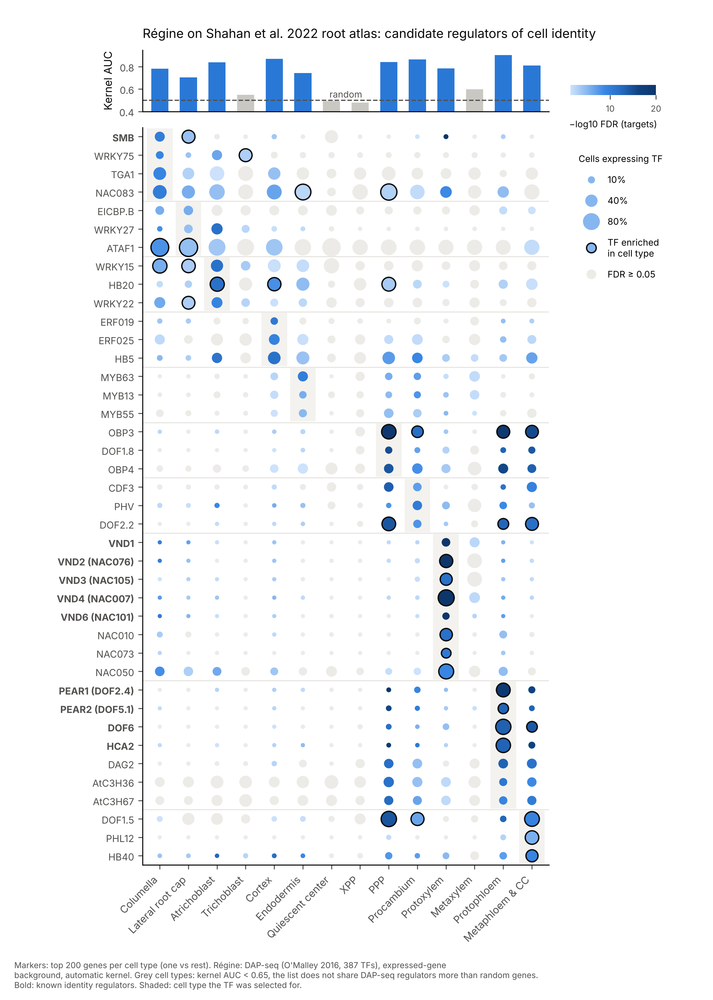

# Case study: regulators of cell identity in the Arabidopsis root single-cell atlas

**Question.** Do the marker genes of each root cell type share DAP-seq regulators, and does Régine recover the transcription
factors (TFs) known to specify these cell types?

**Answer.** Yes, for 10 of the 14 cell types. Without any prior knowledge, Régine puts the known identity regulators at the
top of their own cell type, once the TF's own expression is taken into account. These are the VASCULAR-RELATED NAC-DOMAIN factors in protoxylem, the PEAR DOF factors in
protophloem and SOMBRERO in the root cap. In each case the TF is also expressed in that cell type.



*Each column is a cell type of the atlas and each row a candidate TF. Colour: −log10 FDR of the enrichment of the TF's DAP-seq
targets among the 200 marker genes of the cell type. Size: fraction of the cells of the type that express the TF. Black
ring: the TF is itself enriched in that cell type. Top: kernel AUC (probability that a kernel of marker genes shares more
TFs than a kernel of random expressed genes). Grey cell types (AUC < 0.65) do not share DAP-seq regulators more than random
genes. Rows: the three most cell-type-specific candidates of each informative cell type, plus the known identity regulators
(bold). PDF: [`results/Regine_Shahan2022_dotplot.pdf`](results/Regine_Shahan2022_dotplot.pdf).*

## Data and methods

* **Atlas.** Shahan R, Hsu C-W, Nolan TM, et al. (2022) A single-cell *Arabidopsis* root atlas reveals developmental
  trajectories in wild-type and cell identity mutants. *Dev Cell* 57:543–560. GEO GSE152766. 110,427 cells, 14 cell types
  (`celltype.anno`, Supplemental Data 3).
* **Marker genes** ([`scripts/01_celltype_stats.py`](scripts/01_celltype_stats.py),
  [`scripts/02_markers.py`](scripts/02_markers.py)). Expression is log1p(UMI / total UMI × 10⁴), and each cell type is
  compared with all other cells. A marker is expressed in ≥ 25% of the cells of the type, has a mean log difference ≥ 0.5
  and pct<sub>in</sub> − pct<sub>out</sub> ≥ 0.15. The top 200 by mean log difference are kept, giving 124 to 200 markers
  per type: [`data/celltype_markers_top200.tsv`](data/celltype_markers_top200.tsv). These lists were recomputed from the
  atlas rather than taken from the paper's tables.
* **Régine** ([`scripts/03_run_regine.mjs`](scripts/03_run_regine.mjs)) runs the engine of the web version (`web/engine.js`)
  with DAP-seq for 387 TFs (O'Malley et al. 2016). The background is the 20,872 genes expressed in ≥ 1% of the cells of at
  least one cell type ([`data/background_expressed_genes.txt`](data/background_expressed_genes.txt)), not the whole genome.
  The kernel size is automatic (2,000 kernels per size, seed 1). Hypergeometric P and BH FDR are computed over the 387 TFs.
* **Cell-type specificity** ([`scripts/04_annotate.py`](scripts/04_annotate.py)) is −log10 FDR in the cell type minus the
  median −log10 FDR over the 13 other cell types. This separates identity regulators from TFs that bind marker genes of every
  cell type. A **candidate** has FDR < 0.05, is expressed in ≥ 10% of the cells of the type
  ([`data/tf_expression_by_celltype.tsv`](data/tf_expression_by_celltype.tsv)) and has specificity > 1.
* **Figure**: [`scripts/05_figure.py`](scripts/05_figure.py).

## Results

| Cell type | Markers | Kernel AUC | TFs FDR < 0.05 | Candidates | Top candidates (\* TF itself enriched in the cell type) |
|---|---|---|---|---|---|
| Protophloem | 134 | 0.905 | 211 | 60 | **PEAR1/DOF2.4\*** (FDR 2·10⁻¹⁹), OBP3\*, OBP4, DAG2, **DOF6\***, **PEAR2/DOF5.1\***, **HCA2\*** |
| Cortex | 159 | 0.870 | 255 | 89 | ERF019, ERF025, HB5, ERF38, HAT2, ERF017 (DREB A-4/A-5 ERFs, HD-Zip) |
| Procambium | 124 | 0.865 | 137 | 27 | OBP3\*, OBP4, MYB13, MYB63, CDF3, PHV |
| Phloem pole pericycle | 163 | 0.844 | 154 | 37 | OBP3\* (FDR 5·10⁻²⁰), DOF1.8, OBP4, DOF1.5\*, CDF3, DOF2.2\* |
| Atrichoblast | 143 | 0.840 | 150 | 54 | WRKY27, WRKY15, HB20\*, WRKY22, HAT2, HB5, ATHB13 |
| Metaphloem & companion cell | 159 | 0.812 | 138 | 29 | DOF6\*, OBP3\*, DOF1.8, OBP4, DAG2, DOF2.2\*, PHL12\*, HB40\* |
| Protoxylem | 200 | 0.786 | 123 | 27 | **VND2\*** (FDR 3·10⁻³²), **VND6**, **VND1**, **VND4\***, NAC010\*, **VND3\***, NAC073\* |
| Columella | 200 | 0.784 | 251 | 72 | **SMB** (FDR 8·10⁻¹¹), WRKY75, TGA1, NAC083, bZIP53\*, ATAF1\* |
| Endodermis | 160 | 0.745 | 102 | 16 | MYB63, MYB13, MYB55, MYB74\*, ATHB13, MYB61 |
| Lateral root cap | 200 | 0.705 | 193 | 58 | CAMTA, WRKY27, ATAF1\*, TGA4, bZIP53\*, NAC083, **SMB\*** |
| Metaxylem | 200 | 0.598 | 27 | 4 | GATA11 (list not informative) |
| Trichoblast | 200 | 0.550 | 11 | 6 | (list not informative) |
| Quiescent center | 200 | 0.492 | 3 | 2 | (list not informative) |
| Xylem pole pericycle | 200 | 0.480 | 2 | 2 | (list not informative) |

VND2 = ANAC076, VND3 = ANAC105, VND4 = ANAC007, VND6 = ANAC101; PEAR1 = DOF2.4, PEAR2 = DOF5.1.

* **Positive controls are recovered in their own cell type.**
  * Protoxylem: the five VNDs present in the DAP-seq set (VND1, 2, 3, 4, 6) are among the top 12 TFs, four of them in the
    top 4, with FDRs down to 10⁻³². VND5 and VND7 have no DAP-seq profile.
  * Protophloem: the four PEAR DOF factors present in the set (PEAR1, PEAR2, DOF6, HCA2) are among the top 14, with FDRs
    down to 10⁻¹⁹. TMO6 and OBP2 have no DAP-seq profile. The PEARs are the mobile DOFs that drive protophloem and
    procambium growth (Miyashima et al. 2019, *Nature* 565:490).
  * Columella and lateral root cap: SOMBRERO (ANAC033), which controls root cap maturation.
  * In each case the regulator is also expressed, and usually enriched, in the cell type its targets point to. Régine uses
    no expression data, so this is independent evidence.
* **Phloem lineages share a DOF signature.** The DOF signature runs from phloem pole pericycle to procambium,
  protophloem and metaphloem, with the strongest and most specific enrichments in protophloem.
* **New hypotheses.** These come from cell types without a classical regulator in the DAP-seq set:
  * Cortex: DREB-type ERFs and HD-Zip I factors (HB5, HAT2).
  * Atrichoblast (non-hair epidermis): HD-Zip (HB20, HAT2, ATHB13) and WRKY factors.
  * Endodermis: cell wall MYBs (MYB63, MYB13, MYB55, MYB61, MYB74). This fits the lignified and suberised Casparian strip
    and suberin lamellae.
* **Where Régine is silent, the AUC says so.** The quiescent center, xylem pole pericycle, trichoblast and metaxylem lists
  do not share DAP-seq regulators more than random expressed genes (AUC ≈ 0.5). Their best-known identity regulators are
  not among the 387 DAP-seq TFs: PLETHORA, WOX5, SHR/SCR, RHD6/RSL, WER/GL2 and VND7. The few TFs with an FDR below 0.05
  in these lists (for example TRB2/TRB5, telomere-repeat binding) are probably not identity regulators. The kernel profile
  therefore works as a built-in diagnostic of whether a list is regulated by the TFs in the cistrome.
* **DAP-seq points to a TF family, and expression picks the member.** Members of a family bind similar motifs, so their
  targets overlap. The VNDs are also strongly enriched among columella and lateral root cap markers (VND6 is first in
  columella, FDR 4·10⁻¹¹). Conversely, SMB is enriched among protoxylem markers (FDR 5·10⁻²¹), where it is not expressed.
  Cell-type specificity and the TF's own expression in the cell type separate the members of a family. A candidate should
  therefore be read as "this family, and this member because it is expressed here".

## Régine 2.0: adding the TARGET network

The same 14 marker lists were run with both networks of Régine 2.0
([`scripts/06_run_target.py`](scripts/06_run_target.py), Python version, same background of expressed genes, 2,000 kernels
per size, seed 1). TARGET (ConnecTF) adds 65 experiments for 57 TFs, 30 of them absent from DAP-seq, and tells whether a TF
induces or represses the genes of the list.

| Cell type | Kernel AUC DAP-seq | Kernel AUC TARGET | Top of the side-by-side table (combined FDR) | What TARGET adds |
|---|---|---|---|---|
| Protophloem | 0.891 | 0.636 | **NAC096** (3·10⁻⁴²), OBP3, PEAR1/DOF2.4, BBX31 | NAC096 induces 44 of the 134 markers; 31 are also bound by it in DAP-seq |
| Protoxylem | 0.793 | 0.585 | **VND2**, **VND6**, NAC096, **VND1** | the VNDs are not in TARGET; NAC096 induces 28 markers |
| Procambium | 0.870 | 0.704 | **MYB61** (3·10⁻²⁵), ZFP4, C2H2, OBP3 | MYB61 induces 44 markers (35 bound and regulated); ZFP4 and C2H2 repress |
| Endodermis | 0.752 | 0.751 | **MYB61** (4·10⁻²⁴), MYB30, C2H2, GATA17L | MYB61 induces 50 markers; it is a secondary cell wall regulator, which fits the lignified Casparian strip |
| Metaphloem & companion cell | 0.808 | 0.736 | **LBD38** (1·10⁻¹⁸), DOF4.7, PEAR1/DOF2.4, HCA2 | LBD38 represses 57 of the markers |
| Metaxylem | 0.609 | 0.699 | **CRF4** (3·10⁻²⁷), bZIP3, CRF2, C2H2 | a list DAP-seq could not explain: the cytokinin response factors CRF4 (root and shoot experiments) and CRF2 induce its markers |
| Cortex | 0.871 | 0.687 | HB-7, HB23, HB33, HB25 | HB-7 and HB6 (HD-Zip I) induce cortex markers, consistent with the DAP-seq HD-Zip signal |
| Atrichoblast | 0.841 | 0.743 | CDF1, HB6, HB32, HB40 | CDF1 and HB6 induce the markers |
| Columella | 0.788 | 0.849 | SNZ, LBD37, TGA1, FBH3 | many TFs both induce and repress markers (less specific) |
| Lateral root cap | 0.712 | 0.812 | HHO6, CDF1, SNZ, HB6 | idem |
| Trichoblast | 0.569 | 0.615 | TGA1, HYH, WRKY15, GATA4 | weak: TGA1 and HYH repress some markers |
| Quiescent center | 0.498 | 0.858 | CRF4, ERF5, CDF1, CRF2 | **artefact**: ribosomal protein genes, see below |
| Xylem pole pericycle | 0.484 | 0.881 | CRF4, ERF5, RAV1, C2H2 | **artefact**: ribosomal protein genes, see below |

VND2 = ANAC076, VND6 = ANAC101; PEAR1 = DOF2.4. Bold: discussed below. Full tables: `results/both_all_celltypes.tsv.gz`
(one row per TF), `results/target_all_celltypes.tsv.gz` (one row per TARGET experiment, with the induced and repressed
tests), `results/target_profiles.tsv` (kernel AUC of both networks).

* **The DAP-seq identity regulators stay on top** in the side-by-side table: the VNDs in protoxylem, the PEAR DOFs in the
  phloem lineages. They are absent from TARGET, so their rank comes from DAP-seq alone.
* **TARGET adds a direction and new candidates.** NAC096 in protophloem and MYB61 in procambium and endodermis are both
  bound (DAP-seq) and regulated (TARGET) by the TF, and they *induce* the markers. LBD38 *represses* the metaphloem
  markers. CRF4 and CRF2 explain the metaxylem list, which DAP-seq did not. These are hypotheses: TARGET is measured in
  protoplasts, not in the cell type.
* **TARGET is less specific than DAP-seq.** A TARGET experiment regulates 2,000 genes on median, so 19 to 62 of the 65
  experiments have an FDR below 5% in each cell type. Read the direction and the TFs that stand out in one cell type, not
  the number of significant experiments.
* **Quiescent center and xylem pole pericycle: a ribosome module, not identity.** These lists, silent in DAP-seq, give the
  highest TARGET AUCs (0.86 and 0.88) and FDRs down to 10⁻¹⁵¹ for CRF4. 135 of the 200 QC markers are induced by CRF4 and
  115 of these 135 are ribosomal protein genes. Several TARGET TFs (CRF4, CRF2, ERF5, RAV1, NAC080, bZIP3) induce the
  ribosomal protein genes in protoplasts, and these two marker lists are rich in them. The kernel profile cannot tell this
  apart from regulation: check the genes behind a very strong TARGET hit.

```sh
python3 case_studies/shahan2022_root_atlas/scripts/06_run_target.py case_studies/shahan2022_root_atlas/results
```

## Files

| | |
|---|---|
| `data/celltype_markers_top200.tsv` | marker genes per cell type, with pct_in, pct_out and mean log difference |
| `data/background_expressed_genes.txt` | the 20,872 expressed genes used as background |
| `data/tf_expression_by_celltype.tsv` | expression of the 387 DAP-seq TFs in each cell type |
| `results/regine_all_celltypes.tsv.gz` | all 387 TFs × 14 cell types: bound genes, fold, P, FDR, Régine score, specificity, TF expression |
| `results/candidates.tsv` | candidates (FDR < 0.05, TF expressed in ≥ 10% of the cells, specificity > 1) |
| `results/kernel_profiles.tsv` | AUC and mean number of common TFs for k = 2…10 |
| `results/Regine_Shahan2022_dotplot.{png,pdf}` | figure |
| `results/both_all_celltypes.tsv.gz` | Régine 2.0, DAP-seq and TARGET side by side: all TFs × 14 cell types |
| `results/target_all_celltypes.tsv.gz` | Régine 2.0, the 65 TARGET experiments × 14 cell types (all, induced, repressed) |
| `results/target_profiles.tsv` | kernel AUC of both networks for k = 2…10 |

Reproduce steps 3 to 5 from the repository (Node ≥ 18, Python 3 with pandas and matplotlib):

```sh
cd case_studies/shahan2022_root_atlas
node scripts/03_run_regine.mjs results && python3 scripts/04_annotate.py results
cp results/regine_profiles.tsv results/kernel_profiles.tsv && python3 scripts/05_figure.py results
```

Steps 1 and 2 need the atlas count matrix (GSE152766, about 3 GB) and are given for completeness.
